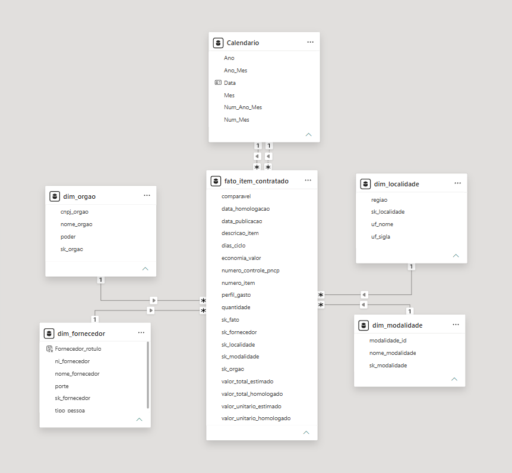

# 📋Projeto Final Módulo 2: Análise de Contratações Públicas do PNCP

**Curso:** Análise de Dados com Python [T2] | Módulo 2 - Projeto Final

**Aluno:** Lucas Lidnei Rodrigues

O objetivo do projeto é construir um pipeline de dados ETL (Extract, Transform, Load) em **Python** e **MySQL**, com um dashboard em **Power BI**, para analisar as contratações públicas disponibilizadas pelo Portal Nacional de Contratações Públicas (PNCP) e responder às perguntas de negócio da Controladoria.

---

## 📌 Desafio

A base fornecida contém informações de compras, itens e resultados de contratações, com problemas de padronização de textos, documentos, números e datas.

Desta forma, foi necessário construir uma solução que:

- Preservasse os três arquivos originais, permitindo a conferência dos dados;
- Auditasse e tratasse as inconsistências com Python e Pandas;
- Aplicasse as regras de negócio para selecionar o vencedor de cada item e identificar os itens válidos e comparáveis;
- Organizasse os dados em um modelo estrela no MySQL, com chaves e restrições de integridade;
- Respondesse às seis perguntas de negócio por consultas SQL;
- Apresentasse os indicadores em um dashboard interativo no Power BI, com menu retrátil, filtros e tooltips contextuais;
- Registrasse o planejamento e o acompanhamento das atividades em sprints.

#### Perguntas de negócio a serem respondidas

1. Qual é o percentual e o valor financeiro nominal economizado pelo governo?
2. Quem são os maiores fornecedores em volume financeiro e qual percentual está concentrado neles?
3. Quais modalidades trazem maior economia e quais concentram o maior volume de recursos?
4. Qual é a duração média entre a publicação e a homologação, segmentada por órgão?
5. Quais estados e regiões concentram as maiores despesas e apresentam os melhores indicadores de desconto?
6. Como os recursos se distribuem entre bens, serviços e obras e engenharia?

---

## 🛠️ Tecnologias utilizadas

| Tecnologia               | Ferramenta             |
| ------------------------ | ---------------------- |
| Linguagem                | Python                 |
| Manipulação de dados   | Pandas                 |
| Banco de dados           | MySQL                  |
| Conexão com banco       | mysql-connector-python |
| Consultas de negócio    | SQL                    |
| Visualização           | Power BI Desktop       |
| Planejamento das sprints | Trello                 |
| Versionamento            | GitHub                 |

#### Fluxo da arquitetura

```text
CSVs brutos fornecidos pelo professor — data/raw/
                         ↓
Python e Pandas — limpeza e aplicação das regras de negócio
                         ↓
CSVs processados — uma fato e quatro dimensões em data/processed/
                         ↓
MySQL — modelo estrela, carga em lote e integridade referencial
                         ↓
SQL — consultas das seis perguntas de negócio
                         ↓
Power BI — medidas DAX, dashboard e análise dos resultados
```

Os dados brutos foram fornecidos em arquivos CSV; este projeto não realiza extração da API. A modelagem final utiliza um esquema estrela, com uma tabela fato e quatro dimensões no MySQL.

---

## 📂 Estrutura do projeto

```text
MODULO 2 - PROJETO FINAL/
├── data/
│   ├── raw/                     # compras.csv, itens.csv e resultados.csv
│   └── processed/               # cinco CSVs gerados; ignorados pelo Git
├── src/
│   ├── limpeza.py               # funções de limpeza e autoteste
│   ├── montar_tabelas.py        # regras de negócio e geração das tabelas
│   ├── carregar.py              # criação do banco, carga e conferências
│   ├── auditoria.py             # conta os problemas dos CSVs antes da limpeza
│   ├── config.py                # caminhos e leitura das credenciais do .env
│   ├── banco.py                 # conexão e funções utilitárias do MySQL
├── sql/
│   ├── 01_criar_banco.sql        # banco, tabelas, chaves e restrições
│   └── 02_perguntas.sql          # consultas das seis perguntas de negócio
├── powerbi/
│   └── Dashboard_PNCP.pbix       # dashboard com seis páginas e dois tooltips
├── docs/img/                    # prints do dashboard e do modelo estrela
├── .env                         # credenciais locais; ignorado pelo Git
├── .gitignore
├── requirements.txt
└── README.md
```

---

## 🔎 Fonte dos dados e auditoria

A base é uma amostra de contratações de órgãos federais, com publicações entre **02/01/2025 e 31/12/2025**, fornecida pelo professor. O processamento utiliza todo o conjunto disponibilizado. Os indicadores representam essa amostra, sem corresponder à totalidade das compras públicas brasileiras.

| Arquivo            | Conteúdo principal                                                    | Registros |
| ------------------ | ---------------------------------------------------------------------- | --------: |
| `compras.csv`    | Órgãos, modalidades, localidades, objeto e datas das compras         |     2.042 |
| `itens.csv`      | Descrição, quantidade, classificação e valores estimados dos itens |     7.077 |
| `resultados.csv` | Fornecedores, classificação, valores homologados e cancelamentos     |    15.896 |

Compras e itens se relacionam por `numero_controle_pncp`. Itens e resultados se relacionam pela combinação `numero_controle_pncp` e `numero_item`. A leitura utiliza `dtype=str` e `keep_default_na=False`, preservando documentos e marcadores de ausência antes da conversão.

#### Ausências e nulos disfarçados

A contagem abaixo considera campos vazios e marcadores como `N/A`, `NULL`, `NONE`, `NaN`, hífen e expressões de ausência, após normalização textual. O zero foi preservado nesta contagem geral para não confundir um número válido com ausência. No processamento, seu tratamento como nulo depende do contexto textual definido em `limpeza.py`.

| Arquivo         | Coluna                         |           Vazios | Marcadores textuais |
| --------------- | ------------------------------ | ---------------: | ------------------: |
| Compras         | `processo`                   |                0 |                  65 |
| Compras         | `modo_disputa`               |                0 |                 960 |
| Compras         | `data_abertura_proposta`     |              617 |                   0 |
| Compras         | `data_encerramento_proposta` |              617 |                   0 |
| Itens           | `categoria_item`             |                0 |               7.077 |
| Itens           | `unidade_medida`             |                9 |                   0 |
| Itens           | `situacao_item`              |                0 |                 195 |
| Itens           | `catalogo_codigo_item`       |            7.068 |                   0 |
| Itens           | `criterio_julgamento`        |                0 |               1.883 |
| Resultados      | `ordem_classificacao_srp`    |           11.976 |                   0 |
| Resultados      | `porte`                      |                0 |               4.836 |
| Resultados      | `data_cancelamento`          |           15.834 |                   0 |
| **Total** | **Todos os arquivos**    | **36.121** |    **15.016** |

São **2.259 ausências em compras**, **16.232 em itens** e **32.646 em resultados**. Ausência não representa necessariamente erro, por exemplo, a data de cancelamento vazia é esperada para resultados não cancelados. Nem todos os campos auditados são utilizados nas tabelas finais.

#### Textos e documentos

| Arquivo e coluna                | Espaços a normalizar | Caracteres invisíveis | Acentuação recuperada |
| ------------------------------- | --------------------: | ---------------------: | ----------------------: |
| Compras: `razao_social_orgao` |                    58 |                      0 |                       0 |
| Compras: `objeto_compra`      |                   519 |                      1 |                      43 |
| Itens: `descricao`            |                   606 |                      0 |                     116 |
| Resultados: `nome_fornecedor` |                   501 |                      0 |                       1 |

As ocorrências medem cada tratamento isoladamente e podem se sobrepor. Os nomes também são padronizados em maiúsculas, com normalização dos hífens.

| Coluna de documento           | Com caracteres não numéricos | Com reposição de zeros à esquerda | Estrangeiros preservados |
| ----------------------------- | -----------------------------: | -----------------------------------: | -----------------------: |
| Compras: `cnpj_orgao`       |                            176 |                                   77 |                        0 |
| Resultados: `ni_fornecedor` |                          1.631 |                                  353 |                       21 |

As duas primeiras contagens consideram documentos nacionais. Não foram encontrados documentos nacionais não ausentes rejeitados pelas regras de conteúdo e comprimento. A rotina remove máscaras e recompõe zeros à esquerda; ela não valida os dígitos verificadores de CPF/CNPJ. Identificadores estrangeiros são preservados em maiúsculas.

#### Números e datas

| Arquivo e coluna                          | Com `R$` | Com vírgula | Valores iguais a zero |
| ----------------------------------------- | ---------: | -----------: | --------------------: |
| Itens: `quantidade`                     |      1.148 |        1.481 |                    16 |
| Itens: `valor_unitario_estimado`        |      1.188 |        1.602 |                    79 |
| Resultados: `quantidade_homologada`     |      2.561 |        3.424 |                   177 |
| Resultados: `valor_unitario_homologado` |      2.650 |        3.614 |                    92 |

Essas quatro colunas não apresentaram ausências nem valores não convertíveis após o tratamento. As contagens são anteriores à seleção do vencedor e às regras de rejeição. A conversão remove `R$`, interpreta separadores brasileiros e internacionais e reconhece negativos. Pela regra da base, um único ponto ou vírgula é decimal; separadores repetidos são de milhar; quando há ambos, o último é decimal.

| Formato de data reconhecido | Compras: `data_publicacao` | Resultados: `data_resultado` |
| --------------------------- | ---------------------------: | -----------------------------: |
| `%Y-%m-%d`                |                        1.319 |                         10.301 |
| `%d/%m/%Y`                |                          243 |                          1.863 |
| `%d-%m-%Y`                |                          138 |                            912 |
| `%d.%m.%Y`                |                          120 |                            937 |
| `%Y/%m/%d`                |                          116 |                            960 |
| `%Y%m%d`                  |                          106 |                            923 |

Os formatos foram identificados após o descarte de horários. Não foram encontradas ausências ou datas não convertíveis nessas duas colunas. A função aceita anos de 2000 até 2030. Após a seleção dos itens válidos, **230 homologações anteriores à publicação** foram anuladas junto com seus ciclos; os itens foram preservados na fato.

---

## 🧹 Regras de negócio e tratamento dos dados

1. **Vencedor por item:** resultados cancelados são removidos. Entre os restantes, vence a menor ordem de classificação, com ausência equivalente a 1; empates são resolvidos pelo menor sequencial numérico.
2. **Quantidade:** utiliza-se a quantidade homologada positiva; caso contrário, a quantidade do item. Os totais estimado e homologado são recalculados com essa mesma quantidade e arredondados em centavos.
3. **Itens inválidos:** são removidos os registros que atendem a pelo menos uma condição de rejeição da tabela abaixo.
4. **Comparabilidade:** modalidades diferentes de Credenciamento e razão homologado/estimado entre 0,1 e 10, inclusive, participam dos indicadores de economia. Os demais itens válidos permanecem no volume total.
5. **Economia:** soma das diferenças entre estimado e homologado dos itens comparáveis. O percentual divide essa soma pelo estimado comparável, sem calcular média de percentuais. Credenciamento apresenta taxa `NULL`, por não possuir base comparável.
6. **Cronologia:** homologação anterior à publicação é anulada, assim como o ciclo. Ciclos de zero dia são válidos.
7. **Perfil do gasto:** palavras inteiras relacionadas a obra, construção, reforma e engenharia, na descrição do item e no objeto da compra, têm prioridade na classificação como “Obras e engenharia”. Nos demais casos, material é “Bens” e serviço é “Serviços”.
8. **Dimensões:** documentos e códigos naturais identificam os registros; chaves substitutas `sk_` fazem as ligações com a fato. A região é derivada da UF e o nome da modalidade é padronizado pelo código.
9. **Ranking de órgãos:** utiliza o nome padronizado, reunindo suas unidades, e considera órgãos com pelo menos cinco itens com ciclo válido. Unidades compradoras são contadas por CNPJ distinto.

#### Seleção e rejeição dos itens

Dos 15.896 resultados, **62 possuem cancelamento preenchido** e são removidos antes da seleção do vencedor. Dos 7.077 itens, **6.225 possuem resultado elegível**; os outros **852 ficam fora da fato** e não integram a contagem de rejeitados.

| Condição de rejeição sobre os 6.225 itens                    | Ocorrências |
| ---------------------------------------------------------------- | -----------: |
| Quantidade utilizada ausente ou não positiva                    |            1 |
| Valor unitário estimado ausente ou não positivo                |           23 |
| Valor unitário homologado ausente ou não positivo              |            6 |
| Orçamento sigiloso                                              |            0 |
| Total estimado inferior a R$ 1                                   |           85 |
| Homologado superior a mil vezes o estimado                       |           60 |
| Algum total superior a R$ 1 trilhão                             |            3 |
| **Itens distintos rejeitados pela união das condições** | **99** |

As condições se sobrepõem e suas contagens não devem ser somadas. O resultado final é **7.077 − 852 − 99 = 6.126 itens** na fato.

---

## 🏗️ Modelagem dimensional

O MySQL utiliza um esquema estrela com cinco tabelas. O grão da fato é **uma linha por item**, identificado por `numero_controle_pncp` e `numero_item`.

| Tabela                   | Chave primária   | Chave natural ou unicidade                 | Registros |
| ------------------------ | ----------------- | ------------------------------------------ | --------: |
| `fato_item_contratado` | `sk_fato`       | `numero_controle_pncp` + `numero_item` |     6.126 |
| `dim_orgao`            | `sk_orgao`      | `cnpj_orgao`                             |       363 |
| `dim_fornecedor`       | `sk_fornecedor` | `ni_fornecedor`                          |     2.652 |
| `dim_modalidade`       | `sk_modalidade` | `modalidade_id`                          |         7 |
| `dim_localidade`       | `sk_localidade` | `uf_sigla`                               |        27 |

Cada dimensão possui relacionamento de um para muitos com a fato. O banco utiliza quatro chaves estrangeiras obrigatórias, `UNIQUE`, `NOT NULL`, `CHECK` e campos monetários `DECIMAL`.

No Power BI, o modelo recebe a tabela **Calendario**, criada em DAX e abrangendo anos completos a partir das datas da base. O relacionamento com `data_publicacao` é ativo; o relacionamento com `data_homologacao` é inativo e utilizado por medidas com `USERELATIONSHIP`. Os filtros seguem das dimensões para a fato, em direção única. A tabela **Indicadores** organiza as medidas e não precisa de relacionamento.

O diagrama abaixo mostra o modelo no Power BI, incluindo o Calendário. O MySQL mantém somente a fato e as quatro dimensões.



---

## ▶️ Como executar o projeto

#### Pré-requisitos

- Python 3.10 ou superior, conforme as dependências do projeto;
- MySQL 8.0.16 ou superior, com serviço ativo e usuário autorizado a criar o banco e as tabelas;
- MySQL Workbench ou outro cliente para executar as consultas;
- Power BI Desktop para abrir o dashboard;
- Os três arquivos originais em `data/raw/`.

#### Instalação e configuração

Abra o terminal na raiz do projeto. No Windows PowerShell:

```powershell
python -m venv .venv
.\.venv\Scripts\python.exe -m pip install -r requirements.txt
```

Crie um arquivo `.env` na raiz com suas credenciais locais. Exemplo com valores fictícios:

```dotenv
MYSQL_HOST=localhost
MYSQL_PORT=3306
MYSQL_USER=seu_usuario
MYSQL_PASSWORD=sua_senha
MYSQL_DATABASE=pncp_controladoria
```

O `.env` é ignorado pelo Git. Utilize `pncp_controladoria` como banco, pois os scripts SQL usam esse nome explicitamente. Variáveis de ambiente já definidas no terminal têm prioridade sobre os valores do arquivo.

#### Sequência de execução

Execute um comando por vez, conferindo o resultado antes de avançar:

```powershell
.\.venv\Scripts\python.exe -m src.auditoria
.\.venv\Scripts\python.exe -m src.limpeza
.\.venv\Scripts\python.exe -m src.montar_tabelas
.\.venv\Scripts\python.exe -m src.carregar
```

- **Auditoria:** apresenta as contagens de ausências, formatos, documentos e motivos de rejeição, sem modificar os dados ou acessar o MySQL. Para salvar o relatório, utilize `python -m src.auditoria --saida reports/auditoria.log`; os arquivos `reports/*.log` são ignorados pelo Git;
- **Limpeza:** executa o autoteste das funções, com 54 exemplos;
- **Construção:** aplica a limpeza e as regras de negócio e grava as cinco tabelas em `data/processed/`;
- **Carga:** executa `sql/01_criar_banco.sql`, carrega as dimensões antes da fato e confere as contagens.

**Atenção à recriação das tabelas:** cada execução de `src.carregar` remove as cinco tabelas existentes e as recria antes da carga. O carregamento confirma os lotes por tabela; uma falha posterior pode deixar uma carga parcial.

Os scripts devem ser executados como módulos, a partir da raiz. Não é necessário executar `config.py` ou `banco.py` separadamente.

Após a carga, abra [sql/02_perguntas.sql](sql/02_perguntas.sql) no Workbench e execute o `USE` inicial e as consultas. Esse arquivo somente lê os dados.

#### Power BI

Abra [powerbi/Dashboard_PNCP.pbix](powerbi/Dashboard_PNCP.pbix) no Power BI Desktop para navegar pelo relatório com os dados importados. Para atualizar a base, execute primeiro o pipeline e configure a fonte MySQL no Desktop para o servidor e o banco do seu ambiente. As credenciais são informadas no próprio Power BI; ele não lê o `.env` dos scripts Python.

Para comparar o painel com as consultas SQL da base completa, limpe as segmentações e as seleções dos gráficos.

---

## 📊 Perguntas de negócio e conclusões

O arquivo SQL contém **sete consultas para responder às seis perguntas**, separando estados e regiões em duas visões. Os percentuais são calculados pelas somas de valores, sem média entre percentuais. No SQL, as taxas são apresentadas na escala de 0 a 100; no DAX, as razões recebem formatação percentual.

#### Respostas às perguntas de negócio

Os valores financeiros abaixo estão expressos em reais.

1. **Qual é o percentual e o valor financeiro nominal economizado pelo governo?**

   A economia nominal é **992.861.686,95**, equivalente a **14,46%** do estimado comparável de **6.867.663.469,91**.
2. **Quem são os maiores fornecedores e qual percentual está concentrado neles?**

   Os dez maiores fornecedores concentram **3.332.484.029,86**, equivalente a **41,43%** do volume. O maior fornecedor é **NOW SEGUROS SA**, com **1.060.000.000,00** e participação de **13,18%**. O ranking utiliza o documento como identidade, preservando a distinção entre filiais.
3. **Quais modalidades apresentam maior economia e maior volume de recursos?**

   O **Pregão Eletrônico** apresenta a maior economia percentual, de **24,02%**. A **Concorrência Eletrônica** concentra o maior volume: **4.700.493.122,98**, equivalente a **58,43%** do total. Credenciamento permanece no volume, mas sua economia percentual é **não aplicável (`NULL`)**.
4. **Qual é a duração média do ciclo de compras por órgão?**

   A média geral é de **48,1 dias**. Entre os **142 órgãos com pelo menos cinco ciclos válidos**, a maior média é de **266,3 dias**. O maior ciclo individual é de **611 dias**. Os **230 itens sem ciclo válido** não participam da média, mas permanecem na fato.
5. **Quais estados e regiões concentram as maiores despesas e apresentam maior desconto?**

   O **Distrito Federal** concentra **3.135.638.456,35**, ou **38,98%** do volume. Em seguida aparecem **Rio Grande do Sul**, com **820.584.056,64**, e **Rio de Janeiro**, com **461.925.602,27**. Entre as regiões, o **Norte** apresenta a maior economia percentual, de **21,43%**. Os indicadores de economia são recalculados sobre a base comparável de cada território.
6. **Como os recursos se distribuem entre bens, serviços e obras e engenharia?**

   | Perfil             |          Volume homologado |   Participação |
   | ------------------ | -------------------------: | ---------------: |
   | Obras e engenharia | **4.892.362.732,70** | **60,82%** |
   | Serviços          | **2.940.950.885,18** | **36,56%** |
   | Bens               |   **211.185.187,86** |  **2,63%** |

   As participações são arredondadas individualmente.

#### Informações adicionais importantes

- **Volume e economia possuem bases diferentes:** o volume considera todos os itens válidos; a economia utiliza somente os **5.457 itens comparáveis**;
- **Total homologado igual a zero:** três itens possuem valor unitário homologado de R$ 0,0001 e quantidade 1, resultando em total zero após arredondamento. Eles permanecem válidos pelas regras do projeto;
- **Contagens no MySQL:** utilize `COUNT(*)`; a quantidade de linhas apresentada nas estatísticas do InnoDB pode ser uma estimativa;
- **Conferências realizadas:** o autoteste aprovou **54 de 54 exemplos**; os CSVs processados não apresentaram duplicidade na chave do item nem referências sem correspondência nas quatro dimensões; as cinco contagens foram confirmadas na carga do MySQL;
- **Períodos de análise:** a publicação é a data padrão. O gráfico temporal por homologação e seu tooltip utilizam a relação específica dessa data.

---

## 🖥️ Dashboard no Power BI

O dashboard possui **seis páginas principais** e **38 medidas explícitas** na tabela **Indicadores**, organizadas em pastas por pergunta de negócio.

| Página            | Conteúdo                                                                                 |
| ------------------ | ----------------------------------------------------------------------------------------- |
| Visão Geral       | Volume, economia, ciclo médio, modalidades, perfil e evolução por publicação         |
| Fornecedores       | Ranking dos dez maiores, concentração, participação e detalhes por documento          |
| Modalidades        | Comparação de volume e economia por modalidade                                          |
| Ciclo de Compras   | Cobertura dos ciclos, média, máximo, ranking de órgãos e evolução por homologação |
| Estados e Regiões | Distribuição territorial do volume e indicadores de economia                            |
| Perfil dos Gastos  | Distribuição entre bens, serviços e obras e engenharia                                 |

#### Navegação e interatividade

- **Menu retrátil:** os visuais ocupam o espaço liberado quando o menu é recolhido. A área de dados passa de 1.048 para 1.248 pixels de largura, preservando os filtros;
- **Indicadores e rodapés:** os cartões repetidos mantêm posições consistentes entre as páginas, e os textos do rodapé respondem às seleções;
- **Limpar filtros:** limpa as segmentações da página. Para desfazer a seleção de um gráfico, clique novamente no elemento selecionado ou em uma área livre desse gráfico;
- **Tooltip “Detalhes do indicador”:** vinculado aos gráficos e tabelas das seis páginas, exceto ao gráfico temporal por homologação;
- **Tooltip “Detalhes por homologação”:** vinculado ao gráfico “Volume por mês de homologação”, em Ciclo de Compras;
- **Modo de edição:** no Desktop, use `Ctrl + clique` para acionar os botões. Para exibir os tooltips, passe o mouse sobre os pontos, categorias ou valores dos visuais.

#### Visão Geral


<details>
<summary>Fornecedores</summary>


</details>

<details>
<summary>Modalidades</summary>


</details>

<details>
<summary>Ciclo de Compras</summary>


</details>

<details>
<summary>Estados e Regiões</summary>


</details>

<details>
<summary>Perfil dos Gastos</summary>


</details>

---

## 🗓️ Planejamento em sprints

O planejamento e o histórico das tarefas estão registrados no quadro do trello.

| Sprint | Objetivo                                            |
| ------ | --------------------------------------------------- |
| 0      | Planejamento, repositório e entendimento dos dados |
| 1      | Auditoria e quantificação das inconsistências    |
| 2      | Funções de limpeza em Python                      |
| 3      | Construção da fato e das dimensões               |
| 4      | Modelagem e carga no MySQL                          |
| 5      | Consultas das perguntas de negócio                 |
| 6      | Dashboard no Power BI                               |
| 7      | Documentação e apresentação                     |


---

## 📝 Conclusões

O projeto atingiu o objetivo de transformar os três arquivos brutos do PNCP em uma base analítica, com tratamento em Python, modelo estrela no MySQL e dashboard no Power BI. A seleção dos resultados elegíveis, o tratamento das inconsistências e as regras de comparabilidade permitiram diferenciar o volume contratado da base utilizada no cálculo da economia.

Os resultados mostram concentração relevante do volume nos dez maiores fornecedores, na Concorrência Eletrônica e em Obras e engenharia. O Pregão Eletrônico apresenta a maior economia percentual entre as modalidades analisadas. A análise territorial evidencia a participação do Distrito Federal, enquanto os indicadores de ciclo permitem comparar órgãos com uma quantidade mínima de observações válidas.

A solução também preserva o contexto dos indicadores: itens sem ciclo permanecem no volume, Credenciamento não recebe taxa de economia artificialmente igual a zero e as participações são calculadas a partir das somas. O dashboard permite explorar esses resultados por meio de filtros, navegação e detalhes contextuais.

#### Melhorias futuras

- Integrar a auditoria a um fluxo de execução automática, com histórico dos relatórios;
- Acrescentar tratamento de exceções, fechamento garantido das conexões e rollback explícito na carga, reduzindo a possibilidade de estado parcial;
- Automatizar a conferência entre os indicadores SQL e os apresentados no dashboard;
- Caso o escopo seja ampliado, avaliar uma extração incremental da API oficial, preservando os arquivos brutos e a rastreabilidade das atualizações.
